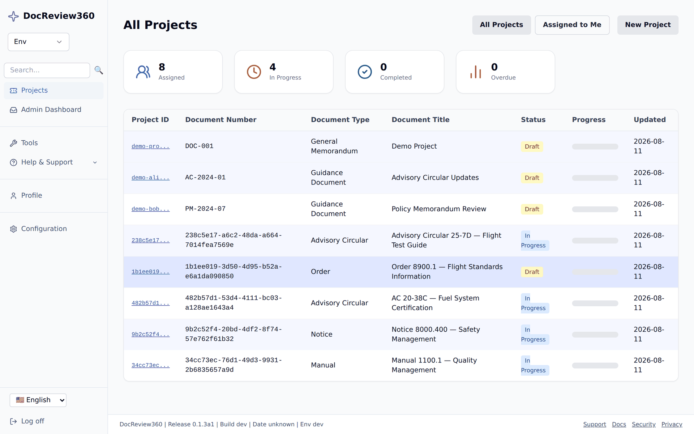
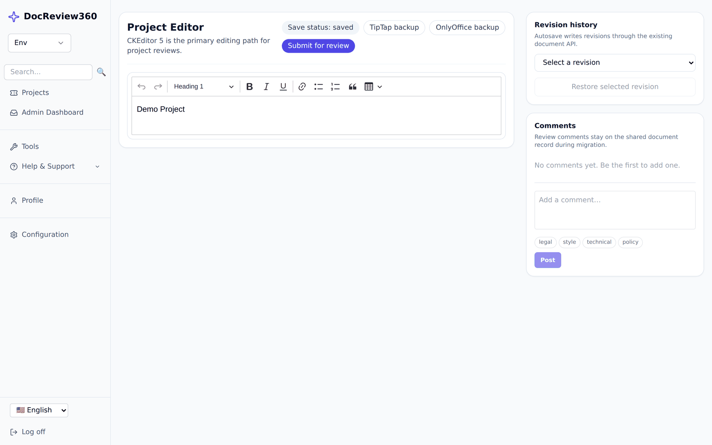

# DocReview360 — Open-Source Document Review and Approval Workflow Software

[](https://pypi.org/project/docreview360/)
[](https://pypi.org/project/docreview360/)
[](https://github.com/eputnam77/DocReview360/actions/workflows/ci.yml)
[](https://eputnam77.github.io/DocReview360/)
[](LICENSE)

**Self-hosted document review, approval, and audit workflow software for technical and regulated documents.**

DocReview360 routes documents through drafting, collaborative review, approval, and publication — with document version control, inline review comments, controlled approval workflows, and a verifiable audit trail. It ships a FastAPI backend, a Next.js frontend, and a `docreview360` CLI.

```
Draft  →  Review  →  Resolve  →  Approve  →  Publish
```



> **Alpha.** The current PyPI release is a pre-release. Interfaces may change between versions.

## Why DocReview360

Most tools do one half of the job: document management systems route and approve, proofing tools review and annotate. DocReview360 covers the whole path — author, review, analyze quality, revise, approve, verify, publish, audit — on infrastructure you run yourself.

| | |
| --- | --- |
| **Document review** | Inline, text-anchored comments alongside the document; parallel or sequential reviewer assignment; reassignment and reminders. |
| **Document approval workflow** | Configurable workflow phases, required approvals, escalations, and digital signatures. |
| **Document version control** | Autosaved revisions with SHA-256 revision hashes and full revision history. |
| **Audit trail** | Hash-chained audit log with CLI verification of the chain and of signatures. |
| **Document quality** | Federal writing-standards validation and optional ONNX critic models, run against the draft in place. |
| **Self-hosted** | SQLite out of the box; PostgreSQL, MySQL, SQL Server, or Oracle for production. LDAP/AD, SAML 2.0, and WebAuthn sign-in. |

Not sure which of our tools fits? See [Choosing between SimpleDocReview and DocReview360](docs/comparison.md).

## Install

```bash
python -m pip install --pre docreview360
docreview360 init
docreview360 migrate
docreview360 serve
```

The base install is the lightweight web review app: FastAPI backend, CLI, SQLite, rich-text authoring and review, notifications, and reviewer management.

Add capabilities with extras, then enable them in the frontend Configuration area:

```bash
python -m pip install --pre "docreview360[postgres]"   # production database
python -m pip install --pre "docreview360[worker]"     # Celery reminders and escalations
python -m pip install --pre "docreview360[ml-cpu]"     # ONNX critic models
python -m pip install --pre "docreview360[saml]"       # SAML 2.0 sign-in
python -m pip install --pre "docreview360[full]"       # everything
```

Run `docreview360 capabilities` to see what is installed.

## Quick start

Requires Python 3.11 or 3.12 (3.13 is not supported) and Node.js 18+.

macOS and Linux:

```bash
git clone https://github.com/eputnam77/DocReview360.git
cd DocReview360
uv venv --python 3.12
source .venv/bin/activate
uv pip install -e ".[dev,test,security]"
DOCREVIEW360_ENV=dev python -m uvicorn docreview360.api:app --reload --port 8000
```

Windows PowerShell:

```powershell
git clone https://github.com/eputnam77/DocReview360.git
cd DocReview360
uv venv --python 3.12
.venv\Scripts\Activate.ps1
python -m pip install -e ".[dev,test,security]"
$env:DOCREVIEW360_ENV="dev"
python -m uvicorn docreview360.api:app --reload --port 8000
```

In a second terminal:

```bash
cd frontend
npm install --legacy-peer-deps
printf "NEXT_PUBLIC_API_BASE=http://127.0.0.1:8000\n" > .env.local
npm run dev
```

Open `http://127.0.0.1:3000` and sign in with `alice` / `password` (admin) or `bob` / `password` (auditor). These demo accounts are seeded only when `DOCREVIEW360_ENV` is `dev` or `test`.

Browse the frontend on the same hostname as `NEXT_PUBLIC_API_BASE`. The session cookie is host-scoped, so mixing `localhost` and `127.0.0.1` signs you out on every page load.

Full walkthrough: [docs/getting_started.md](docs/getting_started.md).

## How it works

Authors draft with autosave and revision history. Reviewers comment alongside the document. Approvers sign off in the order the workflow defines.



Every action is written to a hash-chained audit log. Documents can be validated against federal writing standards before they go out.


## Documentation

Full documentation site: **<https://eputnam77.github.io/DocReview360/>**

| Topic | Link |
| --- | --- |
| Get started | [docs/getting_started.md](docs/getting_started.md) |
| CLI reference | [docs/cli.md](docs/cli.md) |
| API overview | [docs/api_overview.md](docs/api_overview.md) |
| Environment variables | [docs/environment_variables.md](docs/environment_variables.md) |
| Settings reference | [docs/settings.md](docs/settings.md) |
| Deployment | [docs/deployment.md](docs/deployment.md) |
| Developer guide | [docs/developer.md](docs/developer.md) |
| Testing and quality | [docs/testing_and_quality.md](docs/testing_and_quality.md) |
| Product comparison | [docs/comparison.md](docs/comparison.md) |
| All documentation | [docs/index.md](docs/index.md) |

## Product notes

- Endpoints are available unprefixed; versioned aliases exist at `/api/v1/*`.
- AI assistance is optional and off by default.
- DocReview360 is not legal advice and is not a certified regulatory compliance system.

## Governance

[Contributing](CONTRIBUTING.md) · [Code of conduct](CODE_OF_CONDUCT.md) · [Security policy](SECURITY.md) · [Terms](TERMS.md) · [License](LICENSE)
