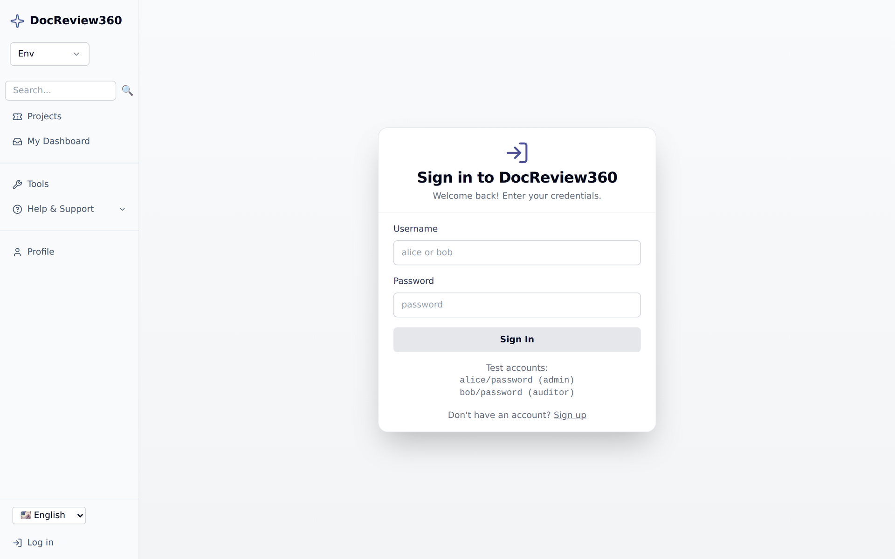

# Get started

Set up DocReview360 on your machine and sign in for the first time.

This guide takes about 10 minutes.

## Before you begin

Install these first:

| Requirement | Version | Notes |
| --- | --- | --- |
| Python | 3.11 or 3.12 | 3.13 is not supported. |
| Node.js | 18 or later | Only needed to run the frontend from source. |
| Git | Any recent version | |

Install [`uv`](https://github.com/astral-sh/uv) to manage the Python environment:

```bash
pip install uv
```

## Step 1: Install the backend

Clone the repository, create a virtual environment, and install the project:

```bash
git clone https://github.com/eputnam77/DocReview360.git
cd DocReview360
uv venv --python 3.12
source .venv/bin/activate
uv pip install -e ".[dev,test,security]"
```

On Windows PowerShell, activate the environment with `.venv\Scripts\Activate.ps1`.

## Step 2: Start the API

Run the server in development mode:

```bash
DOCREVIEW360_ENV=dev python -m uvicorn docreview360.api:app --reload --port 8000
```

`DOCREVIEW360_ENV=dev` does two things: it skips the production secret checks, and it seeds the demo users you sign in with below. Never set it in production.

The API is now at `http://127.0.0.1:8000`. Interactive API docs are at `http://127.0.0.1:8000/docs`.

## Step 3: Start the frontend

In a second terminal:

```bash
cd frontend
npm install --legacy-peer-deps
printf "NEXT_PUBLIC_API_BASE=http://127.0.0.1:8000\n" > .env.local
npm run dev
```

Use the same hostname for both servers. The session cookie is scoped to its host, so browsing the frontend at `localhost` while the API is at `127.0.0.1` signs you out on every page load.

## Step 4: Sign in

Open `http://127.0.0.1:3000/login` and sign in with one of the seeded demo accounts:

| Username | Password | Role |
| --- | --- | --- |
| `alice` | `password` | Admin |
| `bob` | `password` | Auditor |



These accounts exist only when `DOCREVIEW360_ENV` is `dev` or `test`. They are never seeded in production.

## Step 5: Explore

After you sign in, DocReview360 opens the project list. Each row is a document moving through review.


Select a project to see its workflow position, approvals, reviewers, and history.


Select **Edit Document** to open the editor. Autosave writes a new revision as you type, and reviewers comment alongside the document.


## Create your first project

1. From the project list, select **New Project**.
2. Enter a document title and pick a document type.
3. Choose a workflow. The workflow decides which approval phases the document moves through.
4. Select **Create**.

Your project appears in the list with a status of **Draft**.

## Configure the application

Generate a `docreview360.yaml` config file with the setup wizard:

```bash
docreview360 init
```

The wizard asks for your database, document editor, CMS integration, and auth method, then writes `docreview360.yaml` to the current directory.

To set secrets and other runtime values, see [Environment variables](environment_variables.md). For a full description of `settings.yaml`, see the [Settings reference](settings.md).

## Next steps

- [CLI reference](cli.md) — manage migrations, roles, and signatures from the terminal.
- [API overview](api_overview.md) — authenticate and call the REST API.
- [Deployment](deployment.md) — run DocReview360 in production.
- [Usage scenarios](scenarios.md) — worked examples of common review flows.

## Troubleshooting

| Symptom | Fix |
| --- | --- |
| Signed out after every page load | Browse the frontend on the same hostname as `NEXT_PUBLIC_API_BASE`. |
| `401 Unauthorized` from the API | Confirm the server started with `DOCREVIEW360_ENV=dev` so demo users are seeded. |
| `RuntimeWarning` about missing environment variables | Expected in development. The server falls back to development defaults. Set the variables to silence it. |
| `Cannot find module 'critters'` | Run `npm install --legacy-peer-deps` again. |
| Python 3.13 install errors | Recreate the environment with `uv venv --python 3.12`. |
