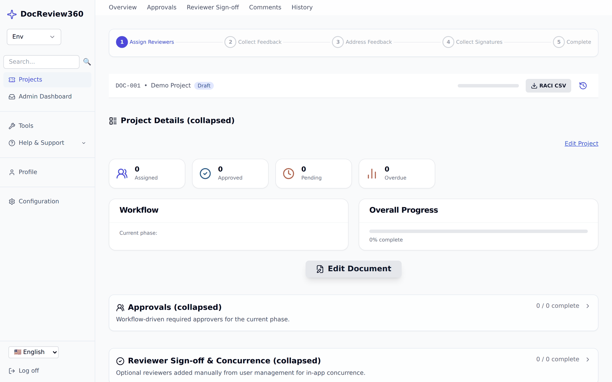
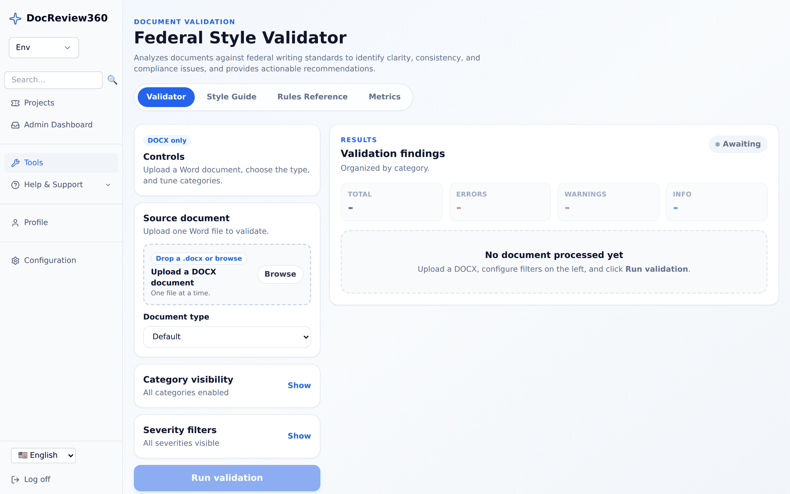
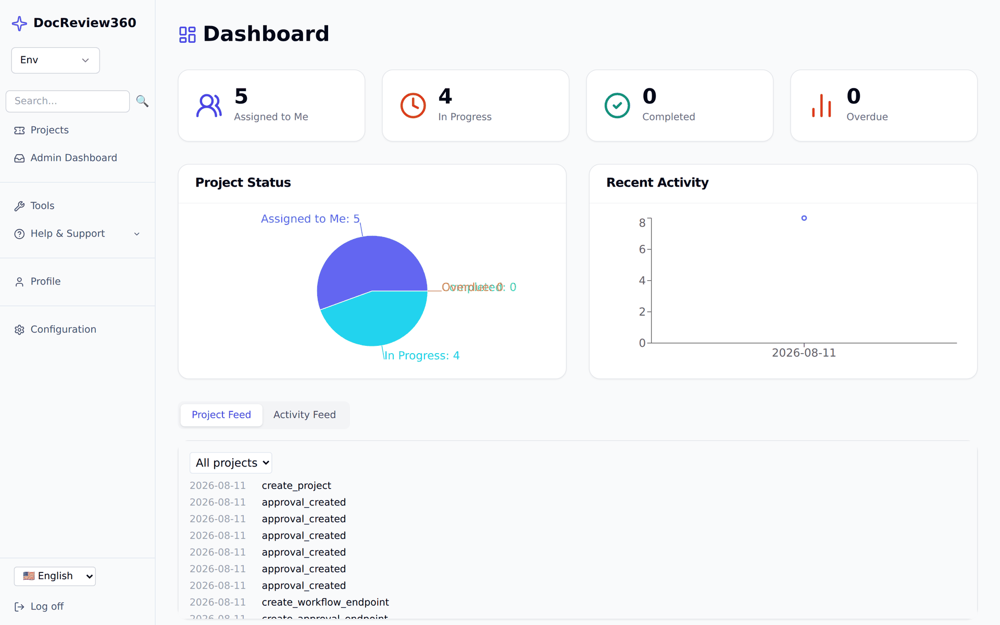

# Usage scenarios

Worked examples of common DocReview360 flows. Each one maps a real task to the API calls behind it.

All examples assume you have a bearer token. See [API overview](api_overview.md) to get one.

## Take a draft through review

You have a Markdown draft and need two approvals before it publishes.

1. **Create the project.** `POST /projects` with a name, document type, and workflow. The workflow determines the approval phases.
2. **Import the draft.** `POST /documents/import` with the file. DocReview360 sanitizes the content and stores revision 1 with a SHA-256 hash.
3. **Edit.** Open the document in the editor. Autosave writes a new revision on each change, so you can compare or restore any earlier version.
4. **Assign reviewers.** `POST /projects/{project_id}/assignments`. Reviewers get a notification and the project appears in their queue.
5. **Collect feedback.** Reviewers comment inline. Each comment anchors to a text range, so authors can jump straight to the passage.
6. **Approve.** Approvers call `POST /projects/{project_id}/approvals/{approval_id}/approve`. The phase advances only when every required approval is in.
7. **Publish.** Export the final revision. The audit log now holds the full chain from import to publication.

## Rebalance work when someone is away

A reviewer goes on leave mid-cycle and their documents must keep moving.

1. Find affected projects with `GET /projects?user={username}`.
2. Reassign an individual approval with `POST /projects/{project_id}/assignments/{assignment_id}/replace`.
3. For a short absence, set a temporary assignee on the project instead. The original owner is restored automatically when the window ends.
4. Nudge stalled reviewers with `POST /projects/{project_id}/assignments/{assignment_id}/remind`.

Every reassignment is recorded, so the audit trail still shows who actually approved what.

## Check a document before it goes out

Validate a document against federal writing standards without leaving the app.

1. Open **Tools → Document Quality**.
2. Upload a DOCX file and choose the document type.
3. Filter by category and severity to focus on what matters.
4. Select **Run validation**.

Findings are grouped by category with specific, actionable fixes.

## Track progress across a portfolio

Managers need a live picture rather than a status meeting.

1. Open the dashboard for counts of assigned, in-progress, completed, and overdue work.
2. Use the project feed for a chronological view of recent activity.
3. Filter the project list by status or document type to find what is stuck.
4. Export to CSV for reporting.

## Prove what happened

An auditor asks who approved a document and when.

1. Open the project's **History** tab for the human-readable trail.
2. Verify log integrity with `docreview360 logs verify-chain`. The audit log is hash-chained, so any edit or deletion breaks the chain and is detected.
3. Confirm signature validity with `docreview360 verify-signatures`.

See [Audit log schema](audit_log_schema.md) for the event format.
